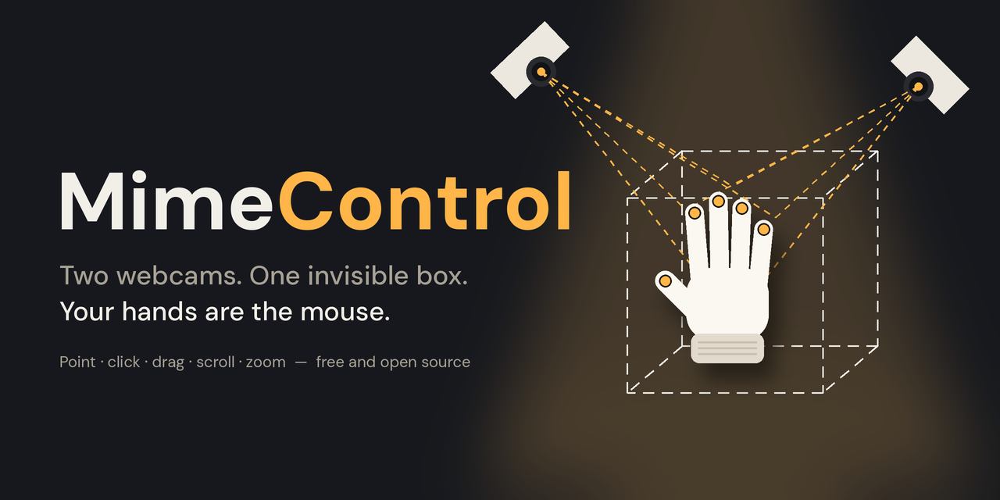
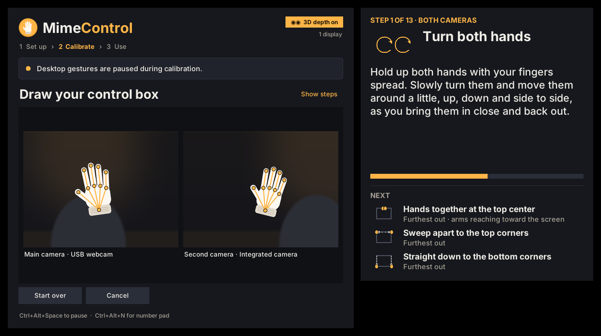
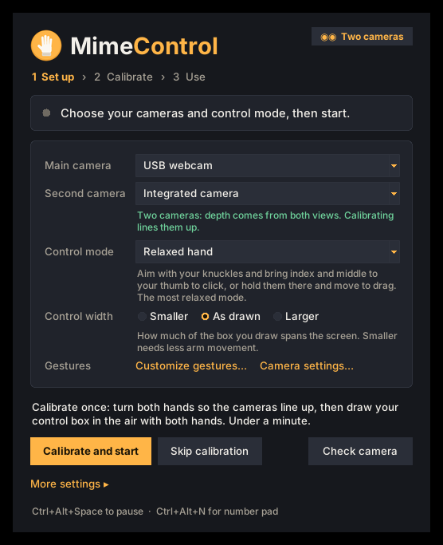
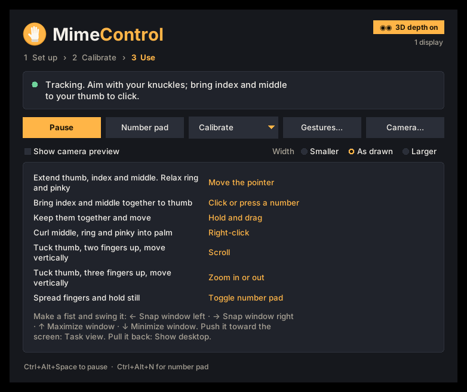

<p align="center">
  
</p>

<p align="center">
  <b>Point, click, drag and scroll with your bare hands.</b><br>
  Two ordinary webcams give MimeControl real 3D depth. Draw an invisible box in the air, like a mime,<br>
  and the space inside it becomes your screen.
</p>

<p align="center">
  <a href="LICENSE"></a>
  
  
  <a href="https://github.com/schoolboynq/MimeControl/actions/workflows/tests.yml"></a>
</p>

---

## Why two cameras?

A single webcam sees a flat picture, so it has to **guess** how far away your hand is from how big it looks. Turn your hand or spread your fingers and that guess wobbles.

Add a second webcam and MimeControl **measures** depth instead, from the two views, the way your two eyes do:

| | One camera | Two cameras |
| --- | --- | --- |
| Distance to your hand | Guessed from apparent size | Measured from both views |
| Turning or tilting your hand | Can shift the measured distance | Doesn't change it |
| The box you draw in the air | Approximate depth | True 3D box |
| Push and pull gestures | Good | Steadier and more reliable |

Any two webcams work, for example a USB webcam on your monitor plus a laptop's built-in camera. There's nothing to measure: during calibration you turn your hands for a few seconds and MimeControl works out where the cameras are and how their timing lines up. One camera still works fine. A second one makes it better.

<p align="center">
  
</p>

## What it does

- **Point** with your knuckles, a relaxed open hand or a fingertip. Five control modes to choose from.
- **Click** by bringing index and middle to your thumb. **Hold and drag** by keeping them together and moving.
- **Right-click, scroll and zoom** with simple hand shapes. Two-hand scroll and zoom are optional.
- **Sticky targets** (Windows): the pointer slows down over buttons, links and other controls so it settles on them, and never jumps.
- **Your invisible box**: draw it once with both hands, then refine it any time or redo a single side.
- **Fist gestures** snap, maximize and minimize windows, open Task View or show the desktop, and you can remap them.
- **Number pad** for typing digits, two-screen switching by reaching or flicking, and built-in **camera settings** (Windows).
- **Private by design**: tracking runs on your computer. No video is recorded or uploaded.

<p align="center">
  
  &nbsp;
  
</p>

## Quick start

1. Install [Python 3.10 or newer](https://www.python.org/downloads/).
2. Download **MimeControl-Setup.zip** from [Releases](https://github.com/schoolboynq/MimeControl/releases/latest) and extract it.
3. Open the launcher. The first launch sets up a private Python environment and downloads dependencies.

| System | Launcher |
| --- | --- |
| Windows 10 or 11 | Double-click **Launch MimeControl.cmd**. Allow desktop apps to use the camera under **Settings → Privacy & security → Camera**. |
| macOS 13+ | Double-click **Launch MimeControl.command**, then allow Camera, Accessibility and Input Monitoring for Terminal or Python. |
| Linux (X11) | Run `python3 launch.py` in the extracted folder. Debian and Ubuntu may need `python3-tk` and `python3-venv`. |

4. Pick your **Main camera** and **Second camera**, choose **Calibrate and start**, and follow the steps panel. It takes under a minute.

### Placing two cameras

- Aim both cameras at the space in front of you where your hands will be. Your forearms should be in view of both.
- Put them **a hand-width or more apart**. Wider spacing measures depth more precisely. Different heights are fine, for example one on top of the monitor and one at the bottom of a laptop screen.
- Keep them still. If you move either camera, choose **Calibrate → Calibrate from scratch**.
- Mixed models, resolutions and frame rates are fine. MimeControl lines up each camera's timing on its own.

## Gestures (Relaxed hand)

| Do this | To |
| --- | --- |
| Extend thumb, index and middle; relax ring and pinky | Move the pointer |
| Bring index and middle together to your thumb | Click |
| Keep them together and move | Hold and drag |
| Curl middle, ring and pinky into your palm | Right-click |
| Tuck your thumb, two fingers up, move vertically | Scroll |
| Tuck your thumb, three fingers up, move vertically | Zoom |
| Spread your fingers and hold still | Number pad |
| Make a fist, pause, then swing, push or pull | Window commands |

**Ctrl+Alt+Space** pauses at any time, and **Ctrl+Alt+N** toggles the number pad. The full **[guide](docs/GUIDE.md)** covers every mode, calibration, refining, sticky targets, two screens, camera settings and troubleshooting.

## Run from source

```bash
git clone https://github.com/schoolboynq/MimeControl.git
cd MimeControl
python -m venv .venv && . .venv/bin/activate   # Windows: .venv\Scripts\activate
python -m pip install -e ".[test]"
python -m mimecontrol      # start the app
python -m pytest           # run the tests
```

## How it works

MimeControl runs a palm detector and a 21-point hand landmark model on the CPU with OpenCV for every camera frame. With two cameras, it matches each hand across the two views and triangulates its depth, after estimating the cameras' relative position and timing from the hand movements you make during calibration. The box you draw becomes a 3D map from your reach to the screen, and the pointer is filtered to stay steady when you hold still and quick when you move. Clicks and drags go through the operating system's normal mouse input.

## Credits

- The hand tracking models are Google's [MediaPipe](https://github.com/google-ai-edge/mediapipe) palm detection and hand landmark models, as converted to ONNX by [OpenCV Zoo](https://github.com/opencv/opencv_zoo) ([palm detector](https://github.com/opencv/opencv_zoo/tree/main/models/palm_detection_mediapipe), [hand pose](https://github.com/opencv/opencv_zoo/tree/main/models/handpose_estimation_mediapipe)). They are licensed under Apache 2.0, and the license ships with them. See [NOTICE](NOTICE).
- Built with [OpenCV](https://opencv.org/), [NumPy](https://numpy.org/), [pynput](https://github.com/moses-palmer/pynput), [python-xlib](https://github.com/python-xlib/python-xlib) and [PyWinRT](https://github.com/pywinrt/pywinrt).

## License

[Apache License 2.0](LICENSE).
